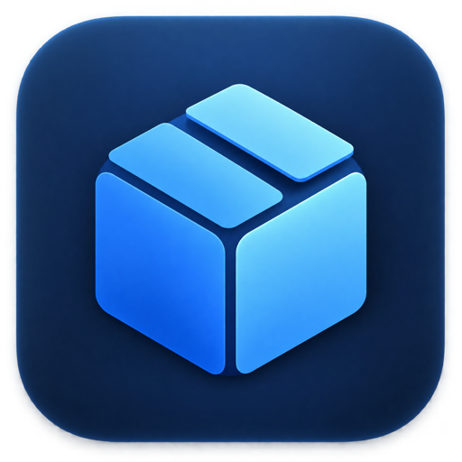
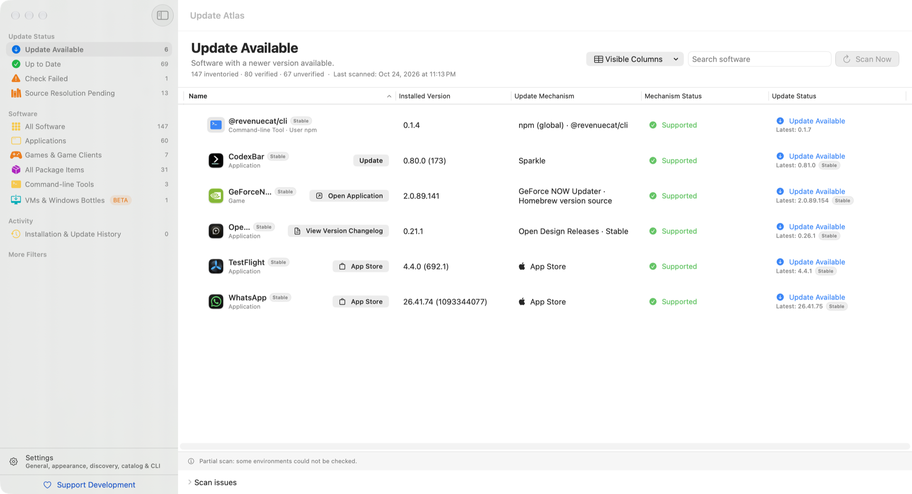

<p align="center">
  
</p>

<h1 align="center">Update Atlas</h1>

<p align="center">
  <strong>Every app on your Mac. Every update, verified.</strong><br>
  A free, open-source macOS app that finds everything installed on your Mac and tells you, with evidence, which updates are real and where to install them.
</p>

<p align="center">
  <a href="https://github.com/alperenalan/UpdateAtlas/releases/latest">Download</a> ·
  <a href="https://updateatlas.alperenalan.com/">Website</a> ·
  <a href="#command-line-tool">CLI</a> ·
  <a href="#support-the-project">Support the project</a>
</p>

<p align="center">
  
  
  
</p>

<p align="center">
  <picture>
    <source media="(prefers-color-scheme: dark)" srcset="Web/site/assets/shots/main-dark.png">
    
  </picture>
</p>

## Why

Most Macs collect software from everywhere: the App Store, developer downloads that update
themselves with Sparkle, Homebrew, game clients, npm and Python packages, command-line tools.
Each has its own updater, and none of them tells you the whole story. Update Atlas puts all of
it in one list and is strict about what it claims: an item is **Up to Date** only after a
reliable version check. Anything it cannot verify stays clearly labelled.

## Features

- **All your software in one list.** Apps, games from Steam, GOG and Epic, Homebrew casks and
  formulae, npm, pip, pipx, uv and Cargo packages, and common command-line tools.
- **Evidence, not guesses.** Every status shows where it came from: the update feed, release
  page or package manager that was checked, and when.
- **Knows who owns each update.** App Store, Sparkle, Homebrew, Microsoft AutoUpdate, Steam,
  the developer's website. For supported apps you can start the update from Update Atlas after
  confirming; scans themselves never install anything.
- **Apps and what is inside them.** Extensions, plug-ins and helpers stay grouped under the app
  that manages them, for example VS Code extensions under VS Code.
- **Menu bar and notifications.** A quiet update count in the menu bar, optional scheduled
  checks, and a notification when new updates are confirmed.
- **Command-line tool and AI agent skill.** The same inventory as JSON for scripts and assistants.
- **Private by design.** No account, no analytics, no ads. Your software list never leaves your Mac.
- **Seven languages.** English, Türkçe, Русский, Deutsch, Français, 简体中文 and 日本語.

## Install

**Download:** grab `Update-Atlas.dmg` from the
[latest release](https://github.com/alperenalan/UpdateAtlas/releases/latest), open it and drag
Update Atlas to Applications. Releases are signed with a Developer ID and notarized by Apple.
Update Atlas updates itself through Sparkle.

**Requirements:** macOS 14 Sonoma or later on an Apple silicon Mac. Intel apps installed on that
Mac are listed too.

## How it works

1. **Scan.** Update Atlas reads app bundles, package-manager records and game-library manifests
   on your Mac. Nothing is executed from the apps it finds.
2. **Identify.** Each item is matched by stable identifiers, such as bundle ID and code-signing
   team, never by display name, against built-in rules and a public, data-only
   [software catalog](__Assets__/Docs/catalog.md).
3. **Check.** Latest versions come from the item's real update source: Sparkle feeds, GitHub
   releases, the App Store, Homebrew, package registries or official vendor pages.
4. **Report.** Each item shows whether an update is available, it is up to date, its updates are
   handled by another app, or it could not be verified, with the evidence one click away.

The software catalog lives at
[`updateatlas.alperenalan.com`](https://updateatlas.alperenalan.com/api/update-atlas/catalog-v1.json)
and is updated independently of the app, so new software can be supported without a new release.
It contains data only: identities, version sources and ownership, never commands or installers.

## Privacy

- Your software list, settings and history stay on your Mac.
- To check versions, the app contacts the update sources of your software (developer feeds, the
  App Store, GitHub, package registries). Those services see a normal web request.
- It downloads the public catalog from the Update Atlas website. No inventory is ever uploaded.
- No analytics, tracking or ads. Read the full [privacy page](https://updateatlas.alperenalan.com/en/privacy/).

## Command-line tool

Update Atlas bundles a read-only `update-atlas` command. Install the link from the app's menu
(**Update Atlas → Install Command Line Tool…**), which places it in `~/.local/bin`.

```sh
update-atlas check --updates-only        # what needs updating, as JSON
update-atlas scan --offline              # local-only inventory, no network
update-atlas skill > SKILL.md            # an Agent Skill for AI coding assistants
```

The CLI never installs updates. The JSON contract, exit codes and filters are documented in the
[CLI contract](__Assets__/Docs/CLI-Contract.md).

## Missing or wrong app?

[Open an issue](https://github.com/alperenalan/UpdateAtlas/issues/new/choose) with the app's name
and where you downloaded it. Please don't paste your whole software list into a public issue.

## Build from source

Requirements: Xcode 26 or later and [XcodeGen](https://github.com/yonaskolb/XcodeGen).

```sh
git clone https://github.com/alperenalan/UpdateAtlas.git
cd UpdateAtlas/Apple
xcodegen generate
open UpdateAtlas.xcodeproj
```

Run the tests with:

```sh
xcodebuild test -project UpdateAtlas.xcodeproj -scheme UpdateAtlas \
  -destination 'platform=macOS,arch=arm64' CODE_SIGNING_ALLOWED=NO
```

The Xcode project is generated: edit `Apple/project.yml`, not the `.xcodeproj`. The app sandbox
is off because Update Atlas has to read app bundles outside its container. More detail lives in
[architecture](__Assets__/Docs/architecture.md) and the [technical notes](__Assets__/Docs/Technical-Notes.md).

## Contributing

Bug reports, catalog additions and pull requests are welcome. Please read
[CONTRIBUTING](.github/CONTRIBUTING.md) first, and report security issues privately as described
in [SECURITY](.github/SECURITY.md).

## Support the project

Update Atlas is free and built by a single developer. If it saves you time, you can support its
development:

- [Sponsor on GitHub](https://github.com/sponsors/alperenalan)
- [Buy me a coffee](https://buymeacoffee.com/alperenalan)
- Or simply star the repository and tell a friend.

Support is optional and never unlocks features.

## License

Copyright © 2026 Alperen Alan. Update Atlas is licensed under the
[GNU General Public License v3.0 only](LICENSE). [Sparkle](https://sparkle-project.org) and other
third-party components keep their own licenses; see [THIRD_PARTY_NOTICES](THIRD_PARTY_NOTICES.md).
